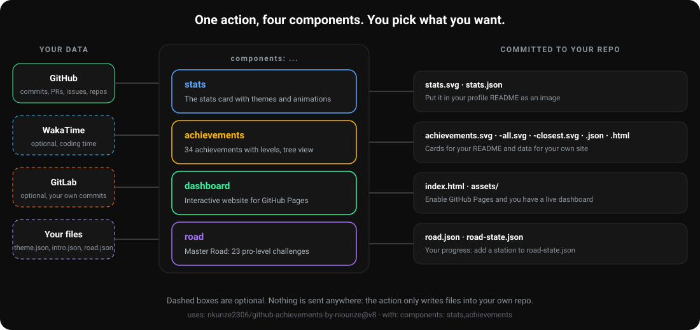
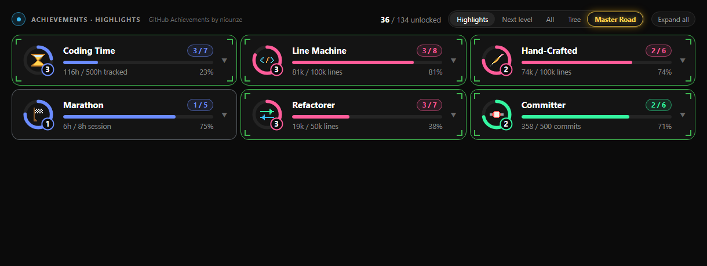
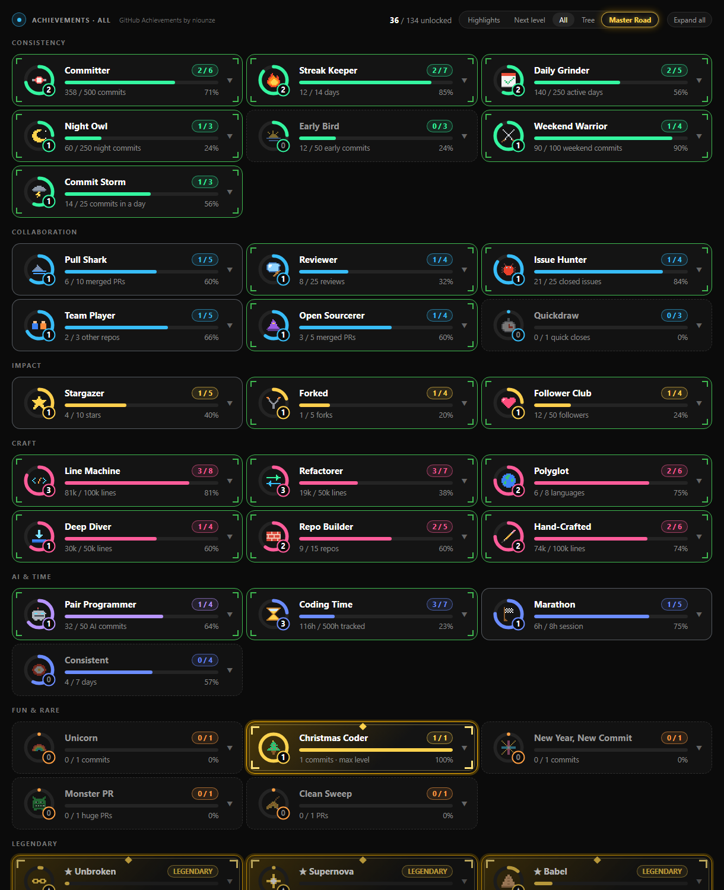
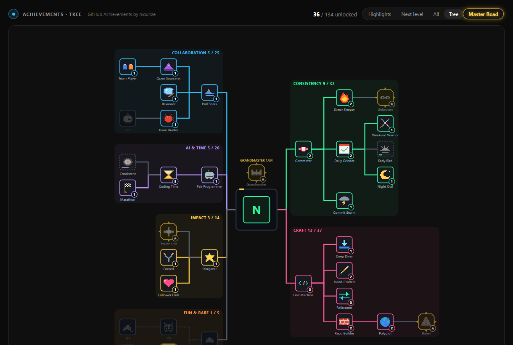
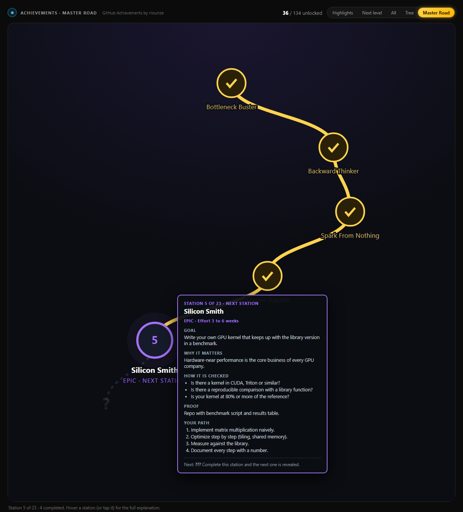
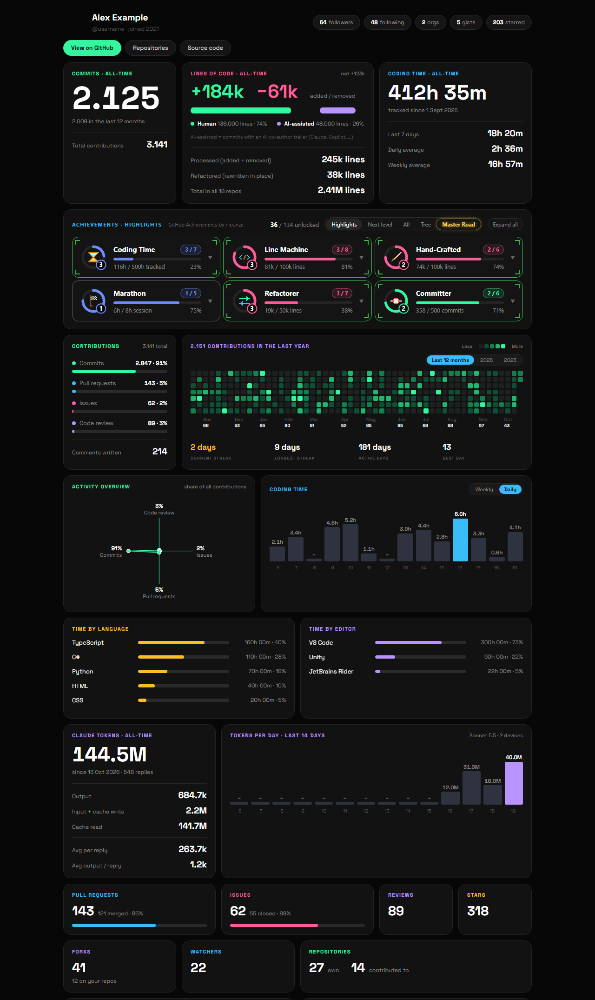

# GitHub Stats & Achievements

A modular, self-updating kit for your GitHub profile. One GitHub Action, four components. Switch on what you like, ignore the rest.
Everything below is rendered from **demo data**, nothing here is a real person's profile.

<p align="center"></p>

<p align="center"></p>

## What you get

| Component | Turns on | What it writes | Looks like |
| --- | --- | --- | --- |
| `stats` | the stats card | `stats.svg`, `stats.json` | the image at the top: commits, lines of code (human vs AI-assisted), contributions, streaks, coding time, languages, 6 achievement highlights, optional animated themes |
| `achievements` | 34 achievements with levels | `achievements.svg`, `achievements-all.svg`, `achievements-closest.svg`, `achievements.json`, `achievements.html` | pixel icons, level rings and tier frames, see below |
| `dashboard` | an interactive website | `index.html`, `assets/` | the full dashboard with tabs for highlights, all achievements, the skill tree and the Master Road. Enable GitHub Pages to publish it |
| `road` | the Master Road | `road.json`, `road-state.json` (created once, never overwritten) | 23 pro-level challenges, only the next one is visible |

Choose with one line: `components: stats,achievements` (default) or `components: stats,achievements,dashboard,road`.
The `dashboard` shows `stats` and `achievements` data, so switch those on too.

### Achievements

<p align="center"></p>

Every achievement has levels. The frame shows how far you are: `Locked`, `Common`, `Uncommon`, `Rare`, `Epic` and `Legendary` (gold, shining). The README card shows your six best **highlights**, ranked by weight in the config.
Also generated: a card with the achievements closest to their next level, and one with all of them.

<p align="center"></p>

### Skill tree

Hover or tap a node for the description, progress and level pips. The golden frame in the middle shows your progress to **Grandmaster**.

<p align="center"></p>

### Master Road

Unlocks at 100 reached achievement levels (`gate` in `road.json`). A single long road with 23 challenges at professional level. **The tasks are hard and meant as real challenges**, not quick wins: each takes weeks or months of focused work. From "make a real app 5x faster" to "become maintainer of a big open-source project".
Only the next station is visible, behind it there is fog. Hover a station for the goal, why it matters, how it is checked, the proof you need and a step-by-step path. See [`docs/ROAD.md`](docs/ROAD.md).

<p align="center"></p>

### Dashboard

<p align="center"></p>

### Themes for the stats card

Animated, pure SVG overlays (no script): `autumn`, `snow`, `sakura`, `rain`, `night`, `butterflies`. Combine several in `theme.json`. Every theme and every setting with its range and default is listed in [`docs/THEMES.md`](docs/THEMES.md).

<p align="center">
  
  
  
</p>

## Quick start (5 minutes)

1. Use your profile repo `<you>/<you>` (create it if it does not exist).
2. Add the secret **`STATS_TOKEN`** in the repo settings: a personal access token with the `repo` and `read:org` scopes counts private repos too (they show up anonymised as "private repo 1"). Without it only public data is used.
3. Create `.github/workflows/stats.yml` from [`examples/minimal-workflow.yml`](examples/minimal-workflow.yml):

```yaml
name: Update stats
on:
  schedule:
    - cron: '0 * * * *'
  workflow_dispatch:
permissions:
  contents: write
jobs:
  update:
    runs-on: ubuntu-latest
    steps:
      - uses: actions/checkout@v4
      - uses: nkunze2306/github-achievements-by-niounze@v8
        with:
          token: ${{ secrets.STATS_TOKEN }}
          components: stats,achievements
          commit: 'true'
```

4. Run the workflow once (Actions > Update stats > Run workflow).
5. Show it in your profile README:

```md

```

The first run can take a few minutes for big accounts, because every branch of every repo is read. Hourly updates are plenty.

## Inputs

| Input | Default | Meaning |
| --- | --- | --- |
| `token` | required | GitHub token. A PAT with `repo` + `read:org` includes private repos |
| `components` | `stats,achievements` | any of `stats`, `achievements`, `dashboard`, `road` |
| `login` | repo owner | whose profile to evaluate |
| `output-dir` | `.` | folder for generated files **and** your own config files (`theme.json`, `intro.json`, ...) |
| `commit` | `false` | `true` commits and pushes the generated files (needs `contents: write`) |
| `timezone` | config default | time zone for night, early and weekend commits, for example `Europe/Berlin` |
| `wakatime-key` | none | optional WakaTime key: adds coding time, language and editor cards and 3 achievements |
| `gitlab-sources` | none | optional JSON list of GitLab hosts and tokens, see below |
| `gitlab-author-emails` | none | your commit e-mails on GitLab |
| `dashboard-auth-client-id`, `dashboard-auth-worker` | none | optional owner login of the dashboard, see [`docs/SETUP-LOGIN.md`](docs/SETUP-LOGIN.md) |

## Make it yours

All of these files are optional and live next to the generated files (`output-dir`):

| File | What it does |
| --- | --- |
| `intro.json` | the greeting at the top of the stats card: `{ "title": "Hey, I'm Alex 👋", "lines": ["I build **small tools**.", "Second line."] }`. Without it the card uses your GitHub name and bio |
| `theme.json` | animated overlays and options, see [`docs/THEMES.md`](docs/THEMES.md) |
| `road.json` | the stations and the unlock level of the Master Road. Edit names, texts and order |
| `road-state.json` | your Master Road progress: `{ "completed": [ { "id": "bottleneck-buster", "proof": "https://github.com/.../pull/1", "date": "2027-01-15" } ] }`. Stations unlock strictly in order |
| `tokens.json` | optional token-usage card for Claude Code, written locally by `tools/track-tokens.mjs`. Only numbers are stored, never conversations |

The achievement list and thresholds come from [`achievements.config.json`](achievements.config.json) of this repo at the version you pin, they cannot be changed from your side.
Want other thresholds? Fork this repo, edit the config and point `uses:` at your fork.

### Data sources

- **GitHub:** all branches of all repos you can see, commits de-duplicated by id, merge commits excluded from line counts. Numbers are higher than GitHub's own contribution counter.
- **WakaTime** (optional): `wakatime-key` adds coding time. The free plan only returns a few days, so the daily values are summed up run after run in `wakatime.json`.
- **GitLab** (optional): pass hosts and tokens (scope `read_api`) and your commit e-mails. **Only commits whose author e-mail is yours are counted**, merge commits are skipped and nothing is logged except totals.

```yaml
gitlab-sources: '[{"host":"https://gitlab.com","token":"${{ secrets.GITLAB_TOKEN }}"}]'
gitlab-author-emails: 'you@example.com,you@university.edu'
```

### Full setup

[`examples/full-workflow.yml`](examples/full-workflow.yml) switches everything on (all four components, WakaTime, GitLab, README image pinning). For saving the theme from the dashboard add [`examples/apply-theme.yml`](examples/apply-theme.yml).

## Built-in achievement metrics

`commits`, `longestStreak`, `activeDays`, `nightCommits`, `earlyCommits`, `weekendCommits`, `maxCommitsPerDay`, `prsMerged`, `reviews`, `issuesClosed`, `foreignRepos`, `foreignMergedPRs`, `quickdraws`, `stars`, `forks`, `followers`, `linesAdded`, `linesDeleted`, `languages`, `topLanguageLines`, `ownRepos`, `handLines`, `aiCommits`, `wakaHours`, `marathonHours`, `consistentDays`, `unicornCommits`, `christmasCommits`, `newYearCommits`, `monsterPRs`, `cleanSweeps`, `maxRepoStars`.
Add your own with a GitHub search, for example `{ "id": "my-prs", "group": "collaboration", "name": "My PRs", "metric": "search", "query": "type:pr author:{login} is:merged", "unit": "PRs", "tiers": [1, 10, 100] }`.

## Run it locally

```bash
node run.mjs --demo --out out                                  # sample data, no token
COMPONENTS=stats,achievements STATS_TOKEN=... STATS_LOGIN=you node run.mjs --out out
node tools/make-docs-images.mjs                                # rebuilds the images in docs/img from demo data
```

Needs Node 20 or newer.

## Privacy and trust

- The action only reads your data and writes files into **your own repo**. It sends nothing to third parties.
- Private repos are counted but never named, they appear as "private repo 1, 2, ...".
- AI-assisted code is detected from commit trailers (`Co-authored-by: Claude / Copilot / ...`). No code is read or judged.
- Pin a version (`@v8`) so the code that runs with your token cannot change under you.

## Repo layout

```
action.yml / run.mjs          entry point, runs the selected components
achievements.mjs + web/       achievements component and its UI
stats/                        stats card, themes, fonts
site/                         dashboard page and the default Master Road
gitlab.mjs                    optional GitLab source (own commits only)
apply-theme/                  small action behind the dashboard "Save & rebuild"
tools/                        local helpers (token usage tracker, login worker, docs images)
docs/ examples/               documentation and ready-to-copy workflows
```

by niounze
